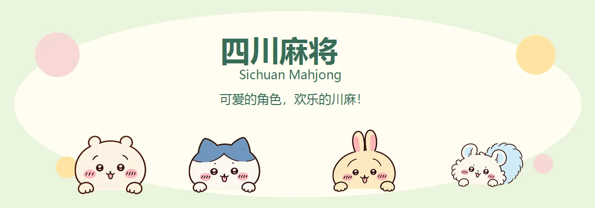
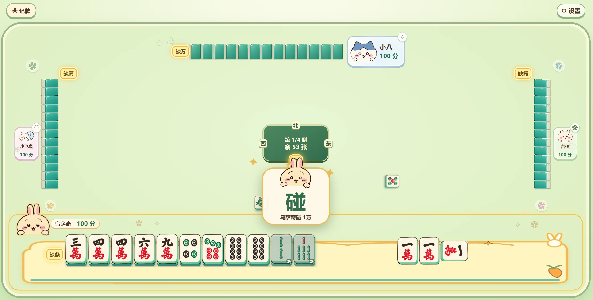
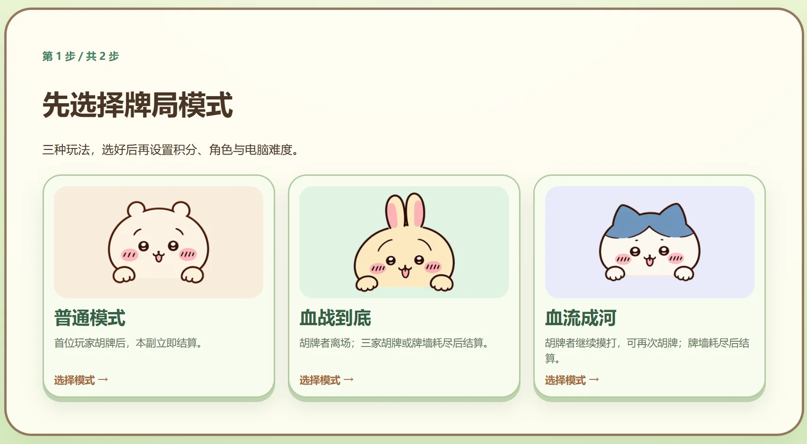
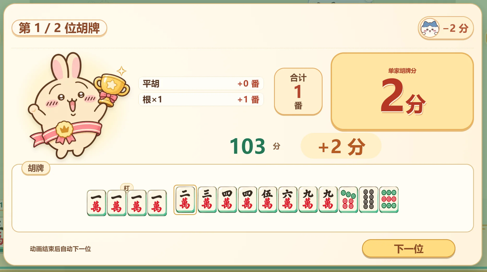

<p align="center">
  <a href="README.md"></a>
  <a href="README.en.md"></a>
</p>

<div align="center">



# Sichuan Mahjong · A Chiikawa-Style Browser Game

**Cute characters, lively Sichuan Mahjong!**

- **Play in your browser without downloading. Supports desktop and mobile browsers.**
- Voice clips for four Chiikawa characters and a selection of background music.
- Three modes: Standard, Blood Battle, and Bloody River, with an optional tile-tracking aid.

  

### [🀄 Play Now](https://lyoko-233.github.io/sichuan-mahjong/) · [Source Code](https://github.com/lyoko-233/sichuan-mahjong)

No installation required · Landscape orientation recommended on mobile · Game version **v43**

</div>

> README updated: 2026-11-07 23:23 (Beijing time, UTC+8). Bilingual introduction: V1; game version remains v43. This is a four-player single-player game with three AI opponents. Online multiplayer is not supported. The language buttons switch the README; the game interface is in Chinese.

## Screenshots

**The table in action:** four player positions, concealed hands, discards, and a pung meld.



**Mode selection:** Standard, Blood Battle, and Bloody River.



**Winning-hand results:** character artwork, fan count, score, and winning tiles.



## Three game modes

| Standard (普通模式) | Blood Battle (血战到底) | Bloody River (血流成河) |
| :---: | :---: | :---: |
|  |  |  |
| The hand ends as soon as the first player wins. | Winning players leave the hand. Scoring takes place when three players have won or the wall runs out. | Players keep drawing and discarding after a win and can win again. The hand ends when the wall runs out. |

Each mode consists of four hands per match. You can enable or disable the opening three-tile exchange, then choose a suit to discard first (定缺). Open “玩法与番数” in the game for the full winning-hand patterns and scoring rules.

## Play alongside four characters

| Chiikawa | Hachiware | Usagi | Momonga |
| :---: | :---: | :---: | :---: |
|  |  |  |  |
| Light green seat | Light blue seat | Light gold seat | Light pink seat |

Each character has matching seat decorations, blinking artwork, and voice clips for pung, kong, and winning calls. A win displays the corresponding character artwork and results animation.

## Choose your AI opponents

| Difficulty | Experience | AI behavior |
| :--- | :--- | :--- |
| Easy | Learn the rules | More frequently selects a lower-ranked discard. |
| Medium | Balanced play | More frequently chooses actions with higher hand-shape and ready-hand scores. |
| Hard | A tougher challenge | Most frequently selects high-scoring actions and considers some discard risks when the wall is running low. |

The AI evaluates hand progress, opportunities to reach a ready hand, and visible tiles. The three levels mainly differ in how often they choose a high-scoring action; no measured win-rate or playing-strength rating is claimed.

## Start playing

1. Open [Play Now](https://lyoko-233.github.io/sichuan-mahjong/).
2. Choose Standard, Blood Battle, or Bloody River, then select your character and AI difficulty.

## For developers

The project uses HTML, CSS, JavaScript ES Modules, and browser LocalStorage, with a playable version hosted on GitHub Pages. No additional frontend framework or build tool is required.

| File | Responsibility |
| :--- | :--- |
| `src/main.js` | Page interactions and game interface |
| `src/engine.js` | Match state and game flow |
| `src/rules.js` | Mahjong rules and winning-hand checks |
| `src/ai.js` | AI decisions |
| `src/audio.js` | Music and sound effects |

Run locally:

```bash
git clone https://github.com/lyoko-233/sichuan-mahjong.git
cd sichuan-mahjong
python -m http.server 8000
```

Open `http://localhost:8000` in your browser. Use a local HTTP server to run ES Modules.

## Version and updates

Current game version: **v43**. The win-on-discard and robbing-a-kong prompts now also offer a “Pass” option when the wall is nearly empty. Default playback gain for character pung, kong, and winning calls has been increased.

[Changelog (Chinese)](CHANGELOG.md) · [Fixed v43 version](https://github.com/lyoko-233/sichuan-mahjong/tree/v43) · [All version tags](https://github.com/lyoko-233/sichuan-mahjong/tags)

## Copyright and acknowledgments

This is an **unofficial fan-style game**. Character designs and related intellectual property belong to their respective rights holders. This project is not affiliated with the official creators. An unofficial or noncommercial designation does not itself grant permission to use characters, artwork, music, or voices.

The repository currently has **no LICENSE file**. It does not declare an MIT, GPL, or other open-source license for the code, and the code and assets should not be treated as having identical licensing terms. Redistribution permissions for some voice and music assets have not been verified; confirm the relevant rights before using or redistributing them. The tile-shuffling sound references element4rt’s [tile shuffle.wav](https://freesound.org/people/element4rt/sounds/454848/) (listed as CC0 on the source page), combined with existing tapping sounds from the project.
