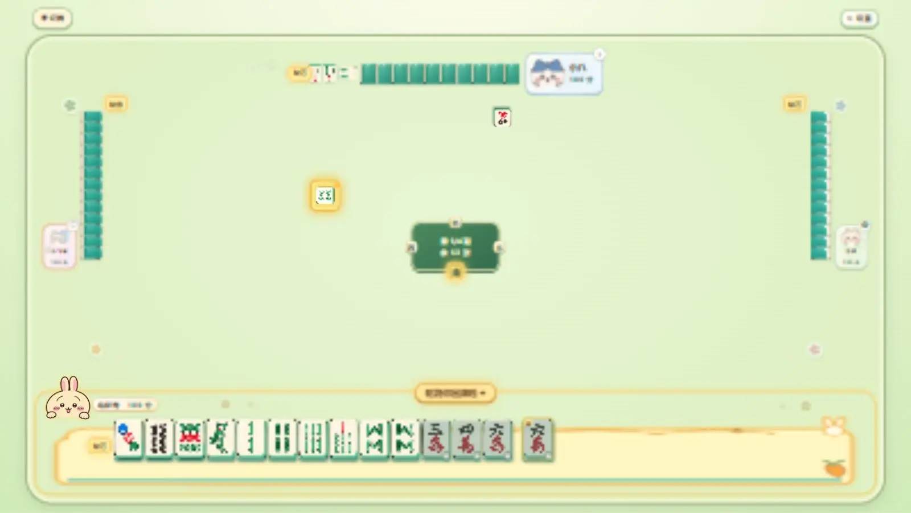

<div align="center">


# 四川麻将 · Chiikawa 风格网页游戏

**Sichuan Mahjong** · 可爱的角色，欢乐的川麻！

三种玩法 · 四位角色 · 三档 AI 难度

  

### [🀄 立即试玩](https://lyoko-233.github.io/sichuan-mahjong/) · [查看源码](https://github.com/lyoko-233/sichuan-mahjong)

无需下载安装 · 手机建议横屏 · 当前游戏版本 **v42**

</div>

> README 修改时间：2026-11-06 15:47（北京时间）。本项目为单机四人游戏，其余三家由 AI 控制，暂不支持在线多人联机。

## 来牌桌看看



上图来自 v42 游戏实机画面。点击上方「立即试玩」，就能进入自己的牌局。

## 三种玩法

| 普通模式 | 血战到底 | 血流成河 |
| :---: | :---: | :---: |
|  |  |  |
| 首位玩家胡牌后，本副立即结算。 | 胡牌者离场；三家胡牌或牌墙耗尽后结算。 | 胡牌后继续摸打，可再次胡牌；牌墙耗尽后结算。 |

三种模式均为四副一场。换三张可在开局时开启或关闭，随后定缺；完整番型与计分说明可在游戏内「玩法与番数」查看。

## 和四位角色一起打牌

| 吉伊 | 小八 | 乌萨奇 | 小飞鼠 |
| :---: | :---: | :---: | :---: |
|  |  |  |  |
| 浅绿牌位 | 浅蓝牌位 | 浅金牌位 | 浅粉牌位 |

四位角色有各自的牌位装饰、眨眼素材，以及碰杠、胡牌语音。胜利时会展示对应角色立绘和结算动画。

## 挑选电脑对手

| 难度 | 对局感受 | AI 实际做法 |
| :--- | :--- | :--- |
| 简单 | 适合熟悉规则 | 更常从次优选择中出牌。 |
| 中等 | 均衡对战 | 更常采用牌型与听牌评分较高的选择。 |
| 困难 | 更认真应对 | 最常采用高评分选择；牌墙较少时还会考虑部分出牌危险度。 |

AI 会评估牌型进度、听牌机会和可见牌；三档主要通过选择高评分动作的频率区分。这里不以未经测试的胜率或棋力数字描述难度。

## 还有这些小乐趣

| 功能 | 游戏中可以做什么 |
| :--- | :--- |
| 经典川麻 | 使用万、筒、条三门牌；可选换三张，随后定缺，并支持碰、杠、胡。 |
| 轻量提示 | 听牌信息与延时出现的听牌金光，帮助寻找可听牌的出牌。 |
| 动画反馈 | 开局整牌翻牌、摸牌与出牌特效，以及逐项出现的胡牌结算。 |
| 音乐与音效 | 四首可选背景音乐、角色音效、麻将动作音效；可分别调整总音量、背景音和打牌音量。 |
| 手机与续局 | 手机浏览器建议横屏；进度保存在当前浏览器，可继续上一场。 |

## 开始游玩

1. 打开 [在线试玩](https://lyoko-233.github.io/sichuan-mahjong/)。
2. 选择普通模式、血战到底或血流成河，再选角色与电脑难度。
3. 开始对局：若开启换三张，先点选同一花色的三张牌并确认；随后选择定缺花色。
4. 轮到你时，点一下手牌选中，再点一次打出。碰、杠、胡出现时，点对应按钮；也可点「忽略」。

对局中可打开「设置」调整音乐音量，查看完整牌河或进入「玩法与番数」。离开后再次打开同一浏览器，可在首页选择「继续本局」。手机端请关闭竖屏锁定并横置屏幕。

## 给开发者

项目使用 HTML、CSS、JavaScript ES Modules 和浏览器 LocalStorage，通过 GitHub Pages 提供试玩。无需额外前端框架或构建工具。

| 文件 | 负责内容 |
| :--- | :--- |
| `src/main.js` | 页面交互与游戏界面 |
| `src/engine.js` | 对局状态与游戏流程 |
| `src/rules.js` | 麻将规则与胡牌判定 |
| `src/ai.js` | AI 决策 |
| `src/audio.js` | 音乐与音效管理 |

本地运行：

```bash
git clone https://github.com/lyoko-233/sichuan-mahjong.git
cd sichuan-mahjong
python -m http.server 8000
```

浏览器打开 `http://localhost:8000`。请使用本地 HTTP 服务运行 ES Modules。

## 版本与更新

当前为 **v42**：自摸胡提示增加「忽略」；自摸回合不显示听牌金光；血战到底与血流成河的模式配图已交换。

[查看更新日志](CHANGELOG.md) · [v42 固定版本](https://github.com/lyoko-233/sichuan-mahjong/tree/v42) · [全部历史标签](https://github.com/lyoko-233/sichuan-mahjong/tags)

## 版权与致谢

本项目是**非官方同人风格游戏**。角色形象及相关知识产权属于相应权利人；本项目与官方无关联。非官方或非商业说明本身不构成对角色、美术、音乐或语音的使用授权。

仓库目前**没有 LICENSE 文件**，因此不声明代码采用 MIT、GPL 等开源许可证，也不将代码与素材视为同一授权。部分角色语音与音乐素材的可再分发许可尚未核实；使用或再分发相关素材前，请另行确认权利。整牌翻牌音效参考了 element4rt 的 [tile shuffle.wav](https://freesound.org/people/element4rt/sounds/454848/)（来源页面标注 CC0），并结合项目已有轻敲声制作。
